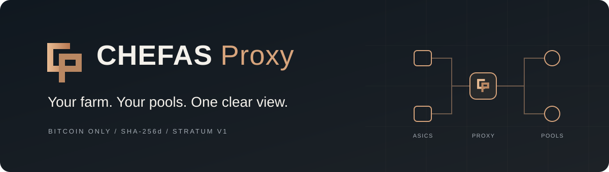

<div align="center">



**Bitcoin mining proxy · BTC / SHA-256d / Stratum V1**

[Download](https://github.com/dmitrogrushdima/chefas-proxy/releases) · [Русский](docs/install.ru.md) · [简体中文](docs/install.zh-CN.md) · [Documentation](docs/README.md)

</div>

CHEFAS runs on your farm computer between your ASICs and your BTC pool. It
provides a local dashboard, shared upstream connections, accepted-work
statistics and a transparent **1% DevFee target**.

**Public pilot.** Start with one ASIC, confirm accepted work at your pool and
keep a direct-pool fallback before connecting the rest of your farm.

## Download

**Current package: [v0.1.0-rc.3](https://github.com/dmitrogrushdima/chefas-proxy/releases/tag/v0.1.0-rc.3)** — Windows and Ubuntu installation checks passed.

Open **[Releases → Assets](https://github.com/dmitrogrushdima/chefas-proxy/releases)**:

| System | Package |
| --- | --- |
| Windows x64 | [Download ZIP](https://github.com/dmitrogrushdima/chefas-proxy/releases/download/v0.1.0-rc.3/chefas-proxy-windows-x64.zip) |
| Ubuntu 24.04 x64 | [Download tar.gz](https://github.com/dmitrogrushdima/chefas-proxy/releases/download/v0.1.0-rc.3/chefas-proxy-linux-x64.tar.gz) |

Download the matching `.sha256` file to verify the archive. Extract the whole
package; keep the executable and `_internal` together. **Python is included.**
GitHub **Code → Download ZIP** contains developer sources, not an installed app.

## Windows: three steps

1. Extract the ZIP into a folder you own and run `start.cmd`. It generates
   `chefas-proxy.json` and private credentials in `.env`, then opens the config.
2. Replace `POOL_HOST` with your BTC pool. For example:
   `"pool_host": "stratum+tcp://btc.viabtc.io:3333"`. Save and run `start.cmd` again.
3. Copy the **ASIC URL** printed in the console into your ASIC's Pool 1.
   Keep its existing worker name and password. Keep the window open.

Your existing direct-pool address should stay in ASIC Pool 2 as a fallback.

## Ubuntu: install as a service

From the extracted package directory:

```bash
sudo bash install.sh
sudoedit /etc/chefas-proxy/chefas-proxy.json
```

Set your BTC pool address as above, then start:

```bash
sudo systemctl enable --now chefas-proxy
sudo journalctl -u chefas-proxy -n 30 --no-pager
```

Copy the **ASIC URL** from the journal into Pool 1. The service runs as the
unprivileged `chefas-proxy` user. The installer generates private credentials
in `/etc/chefas-proxy/chefas-proxy.env` and preserves existing configuration.

## Open your dashboard

On the proxy computer, open **http://127.0.0.1:8080** and sign in with
`CHEFAS_PROXY_ADMIN_TOKEN`:

- **Windows:** open `.env` with Notepad and copy that value.
- **Ubuntu:** display just the token with:

  ```bash
  sudo sed -n 's/^CHEFAS_PROXY_ADMIN_TOKEN=//p' /etc/chefas-proxy/chefas-proxy.env
  ```

Do not share the environment file or publish the dashboard port. To open it
from another computer, follow the [SSH access guide](docs/quickstart.md#open-the-dashboard).
The farm administrator manages their own workers and pool routes. The
maintainer's private VPS controls and manual DevFee rates are separate.

## How the 1% works

The release targets **1% of difficulty accepted by the pool**, rather than
share count or monetary payouts. It schedules bounded DevFee job windows and
keeps each share bound to the job and upstream that produced it. Whole shares,
outages and short measurement windows cause temporary deviations. It does
not split a single share or credit one job to two accounts.

The operator release fixes the rate and DevFee route. Its dashboard shows
accepted work and the remaining balance. Firmware capabilities determine
whether a job-context change can retain the ASIC socket or needs a reconnect.
[Accounting and limits](docs/engineering/devfee.md).

## Compatibility and troubleshooting

BTC Stratum V1 only; model/firmware combinations require pilot verification.
A successful two-device test does not certify every miner or pool. No fixed
hashrate, perfectly flat graph or zero-reject guarantee is made.

[Install / remote access / rollback](docs/quickstart.md) · [Compatibility](docs/compatibility.md) · [Build and release](docs/release.md)

## For developers

```bash
python -m pip install -r requirements.txt pytest
python -m pytest -q
```

| Directory | Purpose |
| --- | --- |
| `src/` | Proxy, routing and accounting |
| `dashboard/` | Local web interface |
| `docs/` | Operator guides and engineering references |
| `scripts/` | Builds, release verification and service templates |
| `requirements/` | Native build and packaging dependencies |
| `tests/`, `lab/` | Regressions and synthetic pools/miners |

[Development guide](docs/development.md). Generated binaries, logs, secrets and
old builds are excluded from Git. Source and tests stay available for review.

## Support and license

[GitHub Issues](https://github.com/dmitrogrushdima/chefas-proxy/issues) · [News](https://t.me/Chefasproxy) · [Community](https://t.me/Chefasproxychat)

[Community and voluntary donations](docs/community.md).

Remove credentials and identifying details from bug reports. Released under
the [MIT License](LICENSE); bundled dependencies retain their own terms.
