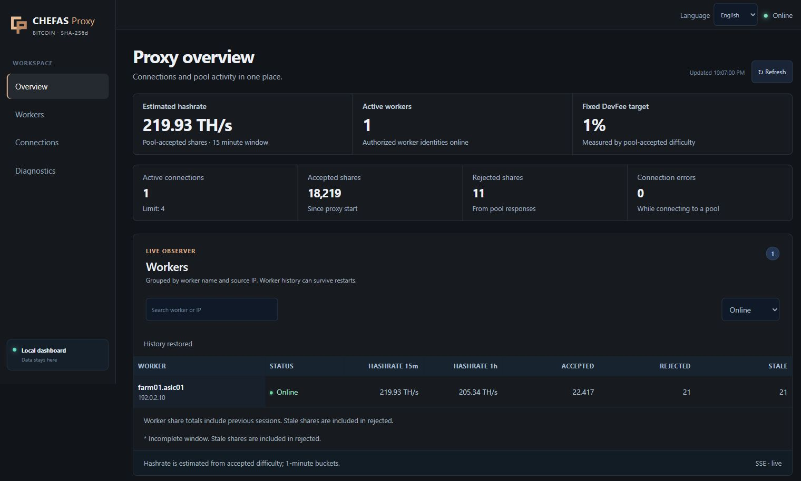

<div align="center">


**Bitcoin mining, with a clearer view of every connection.**

[](docs/release.md)
[](docs/release.md)
[](docs/release.md#linux-service)
[](#license)

[](https://github.com/dmitrogrushdima/chefas-proxy/releases)
[](https://t.me/Chefasproxy)
[](https://t.me/Chefasproxychat)

**Installation:** [English](docs/quickstart.md) · [Русский](docs/install.ru.md) · [简体中文](docs/install.zh-CN.md)

[Quick start](#install-on-your-farm) · [Web dashboard](#open-the-dashboard) · [Compatibility](#pools--hardware) · [Documentation](docs/README.md) · [Support development](#support-development)

</div>

**CHEFAS Proxy** sits between your Bitcoin ASICs and mining pools. Route connections, follow worker activity and inspect the DevFee ledger from a local dashboard. Built exclusively for **BTC · SHA-256d · Stratum V1**.



*Read-only operator view with real field statistics. Worker name and IP are
anonymized; hashrate is an example measurement, not a performance promise.*

## Install on your farm

### Download

**Current package: [v0.1.0-rc.4](https://github.com/dmitrogrushdima/chefas-proxy/releases/tag/v0.1.0-rc.4)** — Windows and Ubuntu installation checks passed.

Open **[Releases → Assets](https://github.com/dmitrogrushdima/chefas-proxy/releases)**:

| System | Package |
| --- | --- |
| Windows x64 | [Download ZIP](https://github.com/dmitrogrushdima/chefas-proxy/releases/download/v0.1.0-rc.4/chefas-proxy-windows-x64.zip) |
| Ubuntu 24.04 x64 | [Download tar.gz](https://github.com/dmitrogrushdima/chefas-proxy/releases/download/v0.1.0-rc.4/chefas-proxy-linux-x64.tar.gz) |

Download the matching `.sha256` file to verify the archive. Extract the whole
package; keep the executable and `_internal` together. **Python is included.**
GitHub **Code → Download ZIP** contains developer sources, not an installed app.

### Windows

1. Extract the ZIP into a folder you own and run `start.cmd`. It generates
   `chefas-proxy.json` and private credentials in `.env`, then opens the config.
2. Replace `POOL_HOST` with your BTC pool. For example:
   `"pool_host": "stratum+tcp://btc.viabtc.io:3333"`. Save and run `start.cmd` again.
3. Copy the **ASIC URL** printed in the console into your ASIC's Pool 1.
   Keep its existing worker name and password. Keep the window open.

Your existing direct-pool address should stay in ASIC Pool 2 as a fallback.

### Ubuntu

From the extracted package directory:

```bash
sudo bash install.sh
sudoedit /etc/chefas-proxy/chefas-proxy.json
```

Set your BTC pool address as above, then start:

```bash
sudo systemctl enable --now chefas-proxy
sudo journalctl -u chefas-proxy -n 30 --no-pager
```

Copy the **ASIC URL** from the journal into Pool 1. The service runs as the
unprivileged `chefas-proxy` user. The installer generates private credentials
in `/etc/chefas-proxy/chefas-proxy.env` and preserves existing configuration.

### Open the dashboard

On the proxy computer, open **http://127.0.0.1:8080** and sign in with
`CHEFAS_PROXY_ADMIN_TOKEN`:

- **Windows:** open `.env` with Notepad and copy that value.
- **Ubuntu:** display just the token with:

  ```bash
  sudo sed -n 's/^CHEFAS_PROXY_ADMIN_TOKEN=//p' /etc/chefas-proxy/chefas-proxy.env
  ```

Do not share the environment file or publish the dashboard port. To open it
from another computer, follow the [SSH access guide](docs/quickstart.md#open-the-dashboard).
The farm administrator manages their own workers and pool routes. The
maintainer's private VPS controls and manual DevFee rates are separate.

## Built around your farm

| Capability | What you get |
| :--- | :--- |
| **Clear operations** | Live worker tables, estimated hashrate, accepted/rejected shares and history checkpoints. |
| **Flexible routing** | User and DevFee upstreams, verified TLS, failover and controlled route changes. |
| **Visible 1% target** | Pool-confirmed difficulty accounting, outstanding DevFee balance and JSON export. |
| **Careful switching** | Hot extranonce changes on capable firmware; controlled reconnect fallback otherwise. |
| **Local protection** | Optional PoW checks, duplicate filtering, bounded buffers, job expiry and idle-session cleanup. |
| **Private administration** | Admin authentication, read-only Observer Links, Kick and IP/CIDR blocking. |

Dashboard languages: **English · Русский · 简体中文**. No cloud account is needed for the local dashboard.

## Pools & hardware

Configure a Bitcoin Stratum V1 endpoint for your pool. These are examples, not endorsements or verified partnerships.

<table>
<tr>
<td align="center" width="25%"><a href="https://www.f2pool.com"><br><strong>f2pool</strong></a><br><sub>Bitcoin · Stratum V1</sub></td>
<td align="center" width="25%"><a href="https://www.viabtc.com"><br><strong>ViaBTC</strong></a><br><sub>Bitcoin · Stratum V1</sub></td>
<td align="center" width="25%"><a href="https://www.antpool.com"><br><strong>AntPool</strong></a><br><sub>Bitcoin · Stratum V1</sub></td>
<td align="center" width="25%"><a href="https://www.poolin.com"><br><strong>Poolin</strong></a><br><sub>Bitcoin · Stratum V1</sub></td>
</tr>
<tr>
<td align="center" width="25%"><a href="https://pool.braiins.com"><br><strong>Braiins Pool</strong></a><br><sub>Bitcoin · Stratum V1</sub></td>
<td align="center" width="25%"><a href="https://foundrydigital.com"><br><strong>Foundry USA</strong></a><br><sub>Bitcoin · Stratum V1</sub></td>
<td align="center" colspan="2"><strong>Your BTC pool</strong><br><sub>Custom host · TCP / TLS</sub></td>
</tr>
</table>

### ASIC hardware

| Family | Bitcoin models | Firmware qualification |
| :--- | :--- | :--- |
| **Bitmain Antminer** | S19 / S21 series | Stock, Vnish and Braiins OS+ builds require model-specific pilot verification |
| **MicroBT Whatsminer** | M30 / M50 / M60 series | Stock firmware qualification pending |
| **Canaan Avalon** | SHA-256d models | Exact model and stock firmware qualification pending |
| **Innosilicon** | Bitcoin SHA-256d models | Exact model and firmware qualification pending |

Protocol capabilities include version rolling and declared extranonce updates. Physical model, firmware and public-pool combinations remain under qualification. [Compatibility matrix](docs/compatibility.md).

## A commission you can inspect

The **1% DevFee target is measured in pool-confirmed difficulty**, not raw share count or monetary payouts. Parallel fee sessions reserve work against one shared budget; the dashboard exposes accepted user/fee work and the remaining balance. Whole shares and network outages can cause short-term deviations.

The operator release fixes the fee rate. The maintainer's manual-rate test
listener and combined VPS dashboard are separate private features, not controls
available to farm users. [How accepted-work quantization works](docs/engineering/devfee.md).

`--require-devfee` enables the watchdog: sustained fee failure stops mining until restart. Configure this availability policy deliberately. Compilation does not make a machine owner's modifications impossible.

**Shared upstream pilot:** `--active-router --aggregate` groups compatible ASICs on shared TCP connections and supports version rolling, automatic pool failover and optional DevFee. [Pilot configuration and limits →](docs/engineering/fleet-scaling.md)

## Community

Join [CHEFAS Proxy News](https://t.me/Chefasproxy) for announcements or [the community chat](https://t.me/Chefasproxychat) for discussion. Use [GitHub Issues](https://github.com/dmitrogrushdima/chefas-proxy/issues) for reproducible bug reports; remove credentials and identifying network details from traces.

## Support development

Voluntary donations support CHEFAS Proxy development and are separate from DevFee.

| | Currency | Network | Address |
| :---: | :--- | :--- | :--- |
|  | **Bitcoin (BTC)** | BTC | `bc1qkwkjk0cgu6zdawx6j5tqlqzl4dcftvt3408rzx` |
|  | **Tether (USDT)** | TRON · TRC-20 | `TPZyEeqNMv9yZmAZWKYnDUkz3sJKxnK8YM` |
|  | **Solana (SOL)** | Solana | `CDY7UUREaDZz56ss4yXfpWvovrw53dSeWyD5koW9y5gN` |


## Documentation & source

[`src/`](src) core · [`dashboard/`](dashboard) interface · [`tests/`](tests) regressions · [`lab/`](lab) synthetic test pools · [`docs/engineering/`](docs/engineering) design and limits.

[Operator guide](docs/quickstart.md) · [Build & release](docs/release.md) · [Development](docs/development.md) · [Upgrade naming](docs/engineering/branding.md)

## License

CHEFAS Proxy is available under the [MIT License](LICENSE). Bundled dependencies retain their own license terms.
